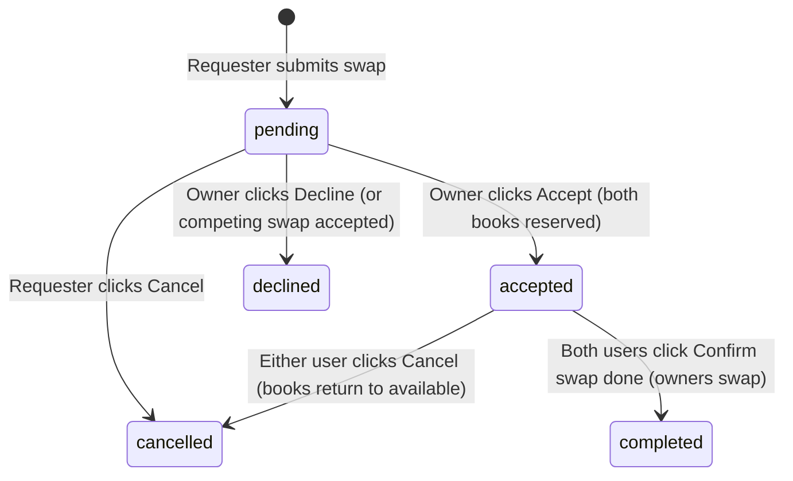

# BookSwap

A student-to-student book exchange web application where students list textbooks and novels they have finished reading and trade them one-for-one with peers — **no money involved**. Built with framework-free OOP PHP, MySQL/MariaDB (PDO), Bootstrap 5, and vanilla JavaScript for local deployment on XAMPP.

[Features](#features) &bull; [Tech Stack](#tech-stack) &bull; [Setup on XAMPP](#setup-on-xampp) &bull; [How a Swap Works](#how-a-swap-works-step-by-step) &bull; [Folder Map](#folder-map)

---

## Features

- **Browse, search, and filter catalog (`index.php`):** Search available books by title or author (`300ms` debounced Fetch calls to `api/books.php`), filter across 8 default categories (`Textbook`, `Fiction`, `Non-fiction`, `Science & Tech`, `Literature`, `Self-help`, `Children`, `Other`), and browse paginated results (`8` books per page).
- **Book listings and cover uploads (`book-form.php`, `my-books.php`, `book.php`):** Create, edit, and delete your available listings with condition tags (`new`, `good`, `fair`, `worn`). Optional cover images (up to `2 MB`) are checked server-side using `finfo` (`FILEINFO_MIME_TYPE`) and `getimagesize()` for real `JPG`, `PNG`, or `WebP` data and stored under random 24-hex filenames in `uploads/`.
- **Accounts, lockouts, and profile management (`signup.php`, `login.php`, `logout.php`, `profile.php`):** Passwords hashed via `password_hash()` / verified via `password_verify()`, session ID regeneration on login (`session_regenerate_id(true)`), HttpOnly + `SameSite=Lax` session cookies, temporary login lockout after `5` failed attempts (`15` minutes), CSRF checks on all forms and JSON `POST` requests, plus display-name and password updates.
- **Transactional book swaps (`swaps.php`, `api/swap.php`):** Grouped swap views (**Incoming**, **Outgoing**, **Active**, **History**) with an incoming pending badge in the navbar, InnoDB `FOR UPDATE` row locking inside database transactions, automatic declining of competing pending offers when a swap is accepted, and ownership transfer only after both participants confirm.
- **Admin dashboard (`admin.php`):** Protected server-side by `Auth::requireAdmin()`. Shows 7 platform counters (**Users**, **Books Listed**, **Available Books**, **Pending Swaps**, **Active Swaps**, **Completed Swaps**, **Completed This Week**), the 10 most recent books with delete moderation, and the registered users table.
- **Hardened server config & safe errors (`.htaccess`, `404.php`, `app/bootstrap.php`):** Directory indexes disabled (`Options -Indexes`), direct HTTP access denied to `app/`, `config/`, and `sql/`, PHP/script execution blocked inside `uploads/`, prepared PDO statements (`PDO::ATTR_EMULATE_PREPARES => false`), HTML output escaping via `e()`, safe DOM creation without `innerHTML`, and exception logging without exposing stack traces or DB credentials to visitors.

---

## Tech Stack

| Layer | Technology | Notes |
|---|---|---|
| **Backend** | PHP 8 (OOP, `declare(strict_types=1)`, no framework) | Syntax verified under XAMPP PHP `8.0.30` |
| **Database** | MySQL / MariaDB (`InnoDB`, `utf8mb4_unicode_ci`) | Accessed via `PDO` singleton ([app/Core/Database.php](app/Core/Database.php)) |
| **UI & Styling** | HTML5, CSS3 ([assets/css/style.css](assets/css/style.css)), Bootstrap `5.3.3` | Bootstrap loaded via jsDelivr CDN ([partials/header.php](partials/header.php), [partials/footer.php](partials/footer.php)) |
| **Client Scripts** | Vanilla ES6 JavaScript (`Fetch API`) | Uses `createElement` + `textContent` and sends `X-CSRF-Token` |
| **Web Server** | Apache (XAMPP) | Uses `.htaccess` rules (`Options -Indexes`, `Require all denied`, `ErrorDocument 404`) |

---

## Setup on XAMPP

> **Verification note:** `php -l` (`PHP 8.0.30`) and `node --check` passed on the repository files, while live XAMPP/Apache execution (`httpd` and `mysqld`) was not run in this environment because those services were stopped. Follow the steps below on your XAMPP machine to run the app.

### 1. Copy the folder to `htdocs`

Copy this project directory into your XAMPP web root so it lives at:

```text
C:\xampp\htdocs\bookswap\
```

*(If you keep the capitalized folder name `C:\xampp\htdocs\BookSwap\`, use `BookSwap` consistently in the URL and `.htaccess` below.)*

Because [`.htaccess`](.htaccess) defaults to root hosting (`ErrorDocument 404 /404.php`), update line 7 of [`.htaccess`](.htaccess) when serving from a subfolder so missing URLs still render the styled [`404.php`](404.php) page:

```apache
ErrorDocument 404 /bookswap/404.php
```

Application links and redirects already auto-detect the subfolder via `BASE_URL` in [`app/bootstrap.php`](app/bootstrap.php).

### 2. Start Apache + MySQL

Open **XAMPP Control Panel** and click **Start** on both **Apache** and **MySQL**.

### 3. Import `sql/schema.sql`

Import [`sql/schema.sql`](sql/schema.sql) using either **phpMyAdmin** or the MySQL CLI:

- **Option A — phpMyAdmin:** Open `http://localhost/phpmyadmin`, click **Import**, choose `C:\xampp\htdocs\bookswap\sql\schema.sql`, and click **Import / Go**.
- **Option B — XAMPP Shell (`cmd`):**
  ```bat
  C:\xampp\mysql\bin\mysql.exe -u root < C:\xampp\htdocs\bookswap\sql\schema.sql
  ```

This script is idempotent (`CREATE DATABASE IF NOT EXISTS`, `CREATE TABLE IF NOT EXISTS`, `INSERT IGNORE`) and creates the `bookswap` database, 4 tables (`users`, `categories`, `books`, `swap_requests`), and 8 default book categories.

### 4. Edit `config/database.php`

Open [`config/database.php`](config/database.php) and confirm the database credentials match your local MySQL server (defaults already match a fresh XAMPP setup):

```php
return [
    'host' => '127.0.0.1',
    'name' => 'bookswap',
    'user' => 'root',
    'pass' => '',
];
```

### 5. Make `uploads/` writable

Ensure the Apache/PHP process can write cover images into `uploads/` (see [`uploads/.htaccess`](uploads/.htaccess) and [`uploads/.gitkeep`](uploads/.gitkeep)):

- **Windows (XAMPP):** Folders inside `C:\xampp\htdocs\` are writable by Apache by default; if Windows read-only/security permissions block uploads, grant Modify/Write access on `uploads\` in **Properties -> Security**.
- **macOS / Linux (XAMPP or Apache):**
  ```bash
  chmod 755 uploads
  ```
  *(Use `chmod 775 uploads` or `chown` to your Apache user/group such as `daemon` or `www-data` if Apache runs under a different account.)*

### 6. Open `http://localhost/bookswap`

Open your browser and visit:

```text
http://localhost/bookswap/
```

Register your first student account on `signup.php` (for example, `you@example.com`). Every new signup is created with `role = 'user'`.

### 7. Make the first admin with SQL

In phpMyAdmin (**SQL** tab on the `bookswap` database) or MySQL CLI, promote your registered account to `admin`:

```sql
UPDATE users
SET role = 'admin'
WHERE email = 'you@example.com';
```

Log out and log back in (or navigate to `http://localhost/bookswap/admin.php`) to open the Admin Dashboard.

---

## How a Swap Works (Step by Step)

BookSwap enforces a strict state machine in [`app/Models/Swap.php`](app/Models/Swap.php) inside MySQL transactions using `SELECT ... FOR UPDATE` row locks (locked in ascending book ID order to prevent deadlocks):



1. **Both students list available books (`status = 'available'`):**
   Student A lists Book X and Student B lists Book Y via `book-form.php`. Only `'available'` books appear in public search on `index.php`.
2. **Propose a swap (`pending`):**
   Student B opens Student A's listing on `book.php?id=...`, selects one of their own `'available'` books (Book Y), and clicks **Send Swap Request**.
   - [`assets/js/book.js`](assets/js/book.js) sends `{ action: 'request', requested_book_id, offered_book_id }` via `POST` to [`api/swap.php`](api/swap.php).
   - `Swap::create()` verifies that both books exist, are `'available'`, belong to the expected users, are not the same book, and have no existing `'pending'` swap for that exact pair.
   - A `swap_requests` row is inserted with `status = 'pending'`. Both books stay `'available'` so an owner can receive multiple offers before deciding.
3. **Owner responds (`accept`, `decline`, or requester `cancel`):**
   Both participants track requests on `swaps.php` ([`assets/js/swaps.js`](assets/js/swaps.js) -> [`api/swap.php`](api/swap.php)):
   - **Decline (owner only, while `pending`):** Marks the swap `'declined'`. Both books stay `'available'`.
   - **Cancel while `pending` (requester only):** Marks the swap `'cancelled'`. Both books stay `'available'`.
   - **Accept (owner only, while `pending`):** Locks both books `FOR UPDATE`, checks both are still `'available'`, updates both books to `status = 'reserved'`, sets the swap to `'accepted'`, and automatically sets every **other** `'pending'` swap involving either book to `'declined'`.
4. **While active (`accepted`):**
   Reserved books are hidden from `index.php` search results and blocked from deletion (`Swap::bookInActiveSwap()`). If the meetup falls through before exchange, **either** student can click **Cancel**, which marks the swap `'cancelled'` and resets both books back to `'available'`.
5. **In-person handoff & dual confirmation (`confirm` -> `completed`):**
   After meeting to trade physical copies, each student clicks **Confirm swap done** on `swaps.php`:
   - **First confirmation:** Sets that user's flag (`requester_confirmed = 1` or `owner_confirmed = 1`) and returns `"Waiting for the other person to confirm"`.
   - **Second confirmation (`requester_confirmed === 1 && owner_confirmed === 1`):** Inside the transaction, `Swap::act()` locks both books, swaps `books.owner_id` (requester receives the requested book; owner receives the offered book), sets both books back to `status = 'available'` (so the new owners can list or swap them again if they choose), and marks the swap `status = 'completed'` with `completed_at = NOW()`.

---

## Folder Map

```text
BookSwap/
├── .htaccess                   # Root Apache rules: Options -Indexes, ErrorDocument 404
├── .gitignore                  # Ignores uploaded images in uploads/ while keeping uploads/.htaccess & .gitkeep
├── README.md                   # Project documentation (this file)
├── 404.php                     # Custom HTTP 404 page
├── index.php                   # Home catalog with search, category filter, and pagination
├── book.php                    # Single book details and swap proposal form
├── book-form.php               # Add / edit book listing with image upload
├── my-books.php                # Logged-in student's book inventory (Edit / Delete)
├── swaps.php                   # Incoming, outgoing, active, and historical swaps
├── admin.php                   # Admin-only metrics, recent books moderation, and user list
├── profile.php                 # Account summary, display name edit, and password change
├── signup.php                  # Student registration
├── login.php                   # Login with CSRF check and brute-force lockout
├── logout.php                  # CSRF-protected POST logout handler
│
├── api/                        # JSON Fetch endpoints (protected by api_guard + X-CSRF-Token)
│   ├── books.php               # GET  - Public paginated book search/filter
│   ├── book_delete.php         # POST - Owner/admin book deletion + image cleanup (active)
│   ├── swap.php                # POST - Unified swap endpoint: request/accept/decline/cancel/confirm (active)
│   └── ...                     # Earlier unreferenced prototypes (admin-delete-book.php, book-delete.php, swap-action.php, swap-request.php, swaps.php)
│
├── app/                        # Core PHP classes & models (direct HTTP blocked via .htaccess)
│   ├── .htaccess               # Require all denied
│   ├── bootstrap.php           # Error settings, dynamic BASE_URL, secure session cookies, autoloader, helpers
│   ├── Core/
│   │   ├── Auth.php            # Session user cache, login/logout, requireLogin/requireGuest/requireAdmin
│   │   ├── Csrf.php            # Per-session CSRF token generation & hash_equals() verification
│   │   └── Database.php        # Final PDO singleton (exceptions, assoc fetch, native prepared statements)
│   └── Models/
│       ├── Book.php            # Book CRUD, finfo/getimagesize upload handler, LIKE search, stats, transactional delete
│       ├── Swap.php            # Atomic swap create/act state machine, FOR UPDATE locks, user lists & stats
│       └── User.php            # User CRUD, password hashing/rehash, 5-attempt/15-min lockout tracking, stats
│
├── assets/
│   ├── css/
│   │   └── style.css           # Minimal Bootstrap overrides, focus-visible rings, and 375px mobile refinements
│   └── js/                     # Vanilla Fetch & DOM scripts (no innerHTML)
│       ├── app.js              # Global helpers, form validation, Fetch wrapper, shared [data-delete-book] handler (active)
│       ├── browse.js           # Home search, debounce, card grid, and pagination (active)
│       ├── book.js             # Swap proposal submission on book.php (active)
│       ├── swaps.js            # Swap action buttons and reload alert flow on swaps.php (active)
│       └── ...                 # Earlier unreferenced scripts (admin.js, book-detail.js, my-books.js)
│
├── config/
│   ├── .htaccess               # Require all denied (protects DB credentials from HTTP reads)
│   └── database.php            # MySQL host, database name, username, and password array
│
├── partials/
│   ├── header.php              # HTML head, CSRF/base-url meta tags, skip link, navbar, #alerts live region
│   └── footer.php              # Closes <main>, loads Bootstrap 5.3.3 bundle, app.js, and optional $pageScript
│
├── sql/
│   ├── .htaccess               # Require all denied
│   └── schema.sql              # Database creation script (4 tables + 8 seeded categories)
│
└── uploads/
    ├── .htaccess               # Disables directory listing & denies PHP/script execution
    └── .gitkeep                # Keeps uploads/ tracked in Git
```
